# Architecture

The edge device (a bus, or any other real-time video site) runs only what
must be near the camera: capture, object detection, the safety gate, and a
durable event publisher. Storage, messaging, alerting, dashboards, MLOps and
fleet control run in the datacenter.

```mermaid
flowchart LR
  subgraph EDGE["EDGE DEVICE: video-detector (RHEL bootc, Podman + Quadlets or MicroShift, x86_64 or Jetson)"]
    CAM["Camera<br/>USB or RTSP (e.g. Nx Witness)"]
    CC["camera-capture<br/>USB / RTSP / video fallback<br/>writes raw frames to /dev/shm"]
    INF["inference-onnx / -tensorrt / -tensorrt-jetson<br/>YOLO object detection<br/>reads /dev/shm, publishes ZeroMQ"]
    CR["clip-recorder<br/>ring buffer in /dev/shm<br/>pre-roll + post-roll on trigger"]
    AD["aggression-detector<br/>Tier 1 gate (persons + motion)<br/>MoViNet A0 action classifier<br/>High / Suspicious / Low"]
    PA["passenger-analytics<br/>centroid tracker<br/>line-crossing counts"]
    EP["event-publisher<br/>SQLite outbox, retry<br/>claim check, health events"]
    CAM --> CC
    CC -- "/dev/shm, zero copy" --> INF
    CC -- "/dev/shm" --> CR
    INF -- "ZeroMQ PUB :5555<br/>detections per frame" --> AD
    INF -- "ZeroMQ PUB :5555" --> PA
    AD -- "1. HTTP: record clip" --> CR
    CR -- "2. HTTP callback: clip ready" --> AD
    AD -- "High / Suspicious + clip" --> EP
    PA -- "counts per window" --> EP
  end

  subgraph DC["DATACENTER: OpenShift"]
    S4[("S4<br/>bucket bus-evidence")]
    K[("AMQ Streams<br/>bus.safety.events<br/>bus.passenger.counts<br/>bus.edge.health")]
    AL["alert-service<br/>page on High, review queue on Suspicious"]
    OD["ops-dashboard<br/>read-only event view"]
    subgraph MLOPS["MLOps (OpenShift AI)"]
      TR["train / evaluate / package modelcar"]
      Q[("Quay<br/>multi-arch images incl. Jetson")]
    end
    FM["Red Hat Edge Manager<br/>fleet, OS image, config"]
  end

  EP -- "3. clip upload (S3, TLS)" --> S4
  EP -- "4. event with evidence ref (SASL_SSL, TLS)" --> K
  K --> AL
  K --> OD
  S4 -. "presigned URL" .-> OD
  S4 -. "hard cases become training data" .-> TR
  TR --> Q
  Q -. "app and model images, incl. Jetson" .-> FM
  FM <-- "device sync" --> EDGE
```

## Event flow (safety path)
1. `camera-capture` reads the camera (USB v4l2 auto-detect, or RTSP if `SOURCE_MODE=rtsp`,
   e.g. pointed at an Nx Witness VMS) and writes frames to `/dev/shm` (POSIX shared memory,
   zero copy). No camera, no RTSP source: it loops video files from `videos/` automatically.
2. `inference-onnx` (or `-tensorrt` / `-tensorrt-jetson`, only one runs at a time) reads
   `/dev/shm` and publishes per-frame object detections over ZeroMQ PUB. This is the real,
   tested object detector from the `object-detection-custom` project, not a stand-in.
3. `aggression-detector` subscribes to the same detections and runs a cheap **Tier 1 gate**
   on every frame: enough people, and enough frame-to-frame motion of their boxes. No model
   inference happens here, just box bookkeeping, so it costs nothing extra on the GPU already
   busy with detection.
4. When the gate opens (and the per-camera cooldown allows it), `aggression-detector` calls
   `clip-recorder` to cut a clip: everything currently in its pre-roll ring buffer (also fed
   from `/dev/shm`), plus a few more seconds recorded after the call.
5. `clip-recorder` posts the finished clip back to `aggression-detector`, which runs it
   through the action classifier (MoViNet A0, stubbed in this scaffold) and maps the score to
   High, Suspicious or Low. Low is dropped.
6. High and Suspicious go to `event-publisher`, which writes to a local SQLite outbox first,
   uploads the clip to S4, then produces the event to AMQ Streams with the S4 reference
   (claim check, the event never carries the video itself).
7. `alert-service` and `ops-dashboard` consume from AMQ Streams. The dashboard builds a
   presigned S4 link for playback.

## Passenger path
`passenger-analytics` subscribes to the same ZeroMQ detection stream (typically a door
camera) and runs a small centroid tracker with a line-crossing counter: each tracked person
who crosses the configured line adds to boarded or alighted for the current window. Windows
post to `event-publisher` on `bus.passenger.counts`, same outbox, lower priority than safety
events.

## Two real-time backbones, one per hop
- **`/dev/shm`** moves frames from capture to inference/recording with zero copies. This is
  the same mechanism the original object-detection-custom project used; it is fast because it
  skips serialization entirely, and it only works between processes on the same host, which
  is exactly the edge device's shape.
- **ZeroMQ PUB/SUB** moves detections from inference to every consumer (gate, tracker,
  viewer) with no broker and low latency, and lets consumers come and go without the
  publisher knowing about them.

Kafka and S3 are deliberately not part of either hop: they run once per event (not once per
frame) and live in the datacenter, reached over the outbox's single outbound TLS connection.

## Why the design looks like this
- Object detection is genuinely real-time (every frame); the action classifier and the
  passenger tracker are event-triggered or windowed, so they can afford a slower path
  (HTTP calls, a clip file) without hurting the frame-rate-critical part.
- Outbox on the edge device gives store-and-forward: in a dead zone or a tunnel, events wait
  in the outbox, then flow when the link returns.
- Evidence is uploaded before the event is published, so nobody sees an event with no video.
- Delivery is at least once. Consumers dedupe on `event_id`.
- Under disk pressure the outbox drops health first, then passenger counts, then Suspicious,
  and High last.

## Two ways to deploy the edge device
`infra/devices/device-images/video-detector/` ships both:
- **Podman + Quadlets** (default): each service is a systemd unit via a `.container` file.
  Simple, no cluster, and the pattern the original object-detection-custom repo already used.
- **MicroShift** (`microshift/` subfolder, optional): the same six services as Kubernetes
  manifests, for sites that standardize on Kubernetes-shaped device management. Pick one, not
  both, per device.

Either way, `/dev/shm` sharing between camera-capture, inference and clip-recorder only works
because this is a single-node edge device — see the caveat in `microshift/README.md`.

## Unattended operations
| Need | How |
| --- | --- |
| Auto Start | bootc image, systemd/Quadlets (or MicroShift) start at boot |
| Camera Recovery | USB/RTSP reconnect with backoff in camera-capture |
| Health Monitoring | `bus.edge.health` event every 30 s from event-publisher, readiness probes |
| Persistent Storage | volumes for outbox, clips, and models (engine cache) |
| Updates | Red Hat Edge Manager rolls the OS image and config, with rollback |

## Security notes
- One Kafka user per device in production, ACL limited to Write on `bus.` topics.
- Rotate the S4 default credentials; use per-device S3 credentials if you can.
- Dashboard is read-only. Put OpenShift OAuth or Keycloak in front of the route.
- Evidence is video of people. Set a retention rule on the S4 bucket and check local privacy rules.
